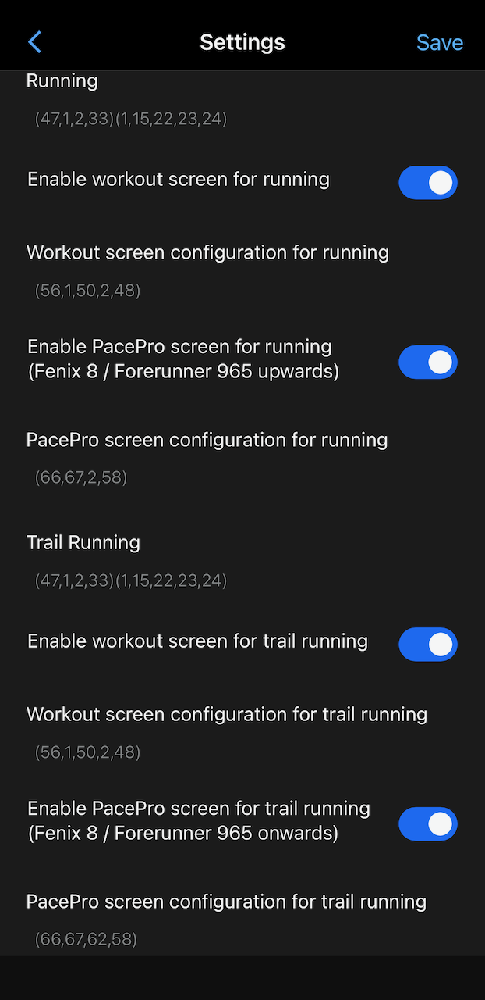
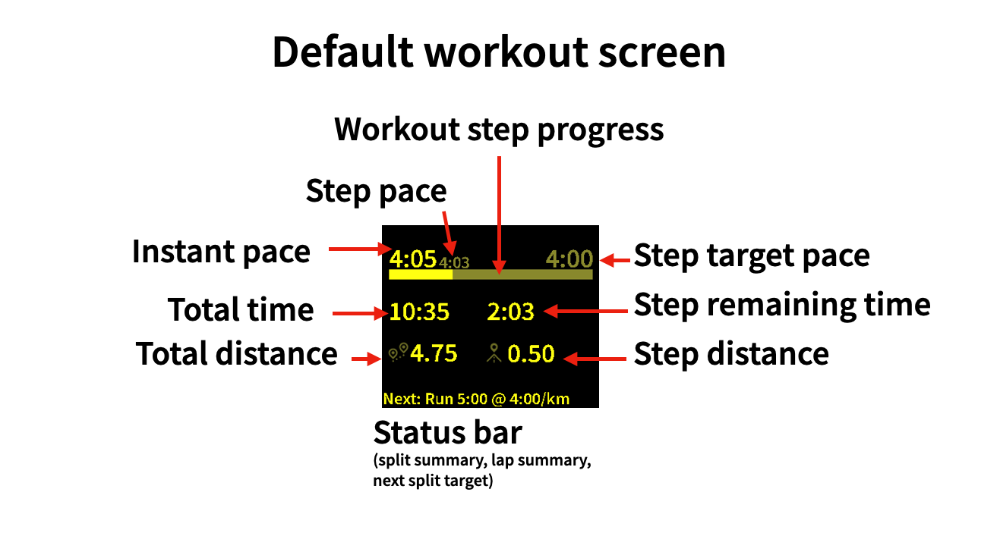
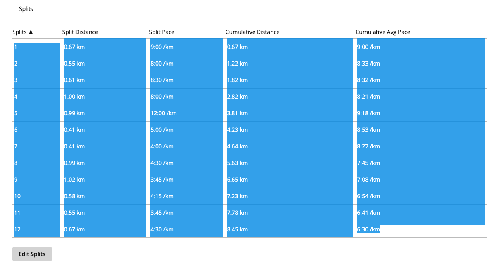
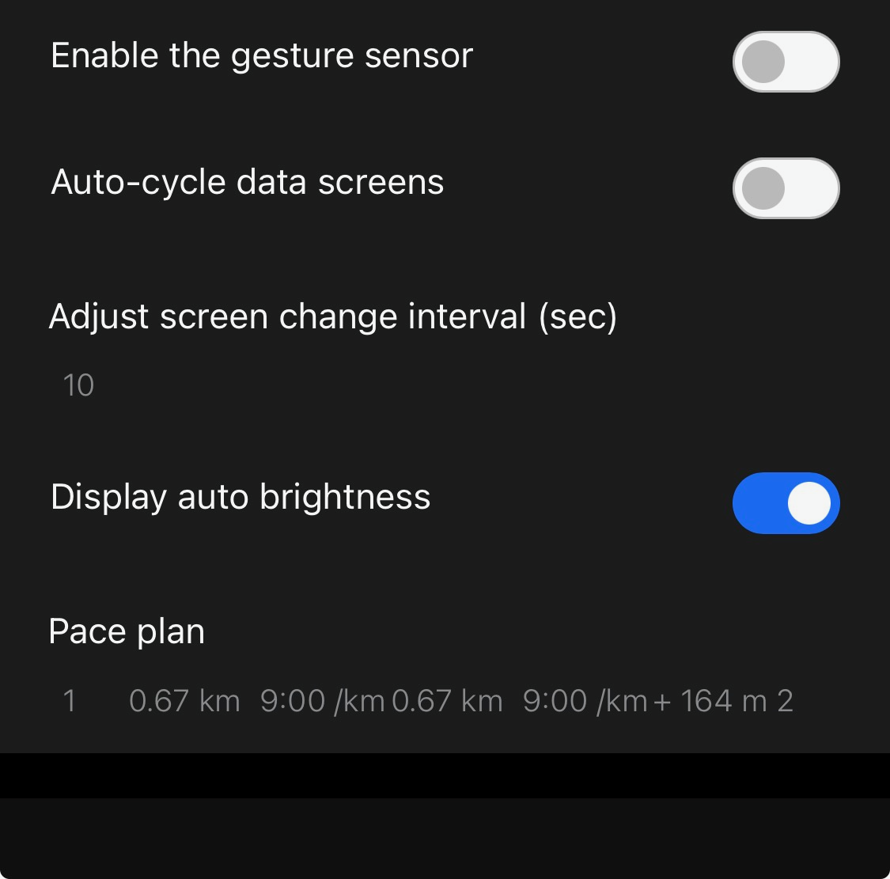
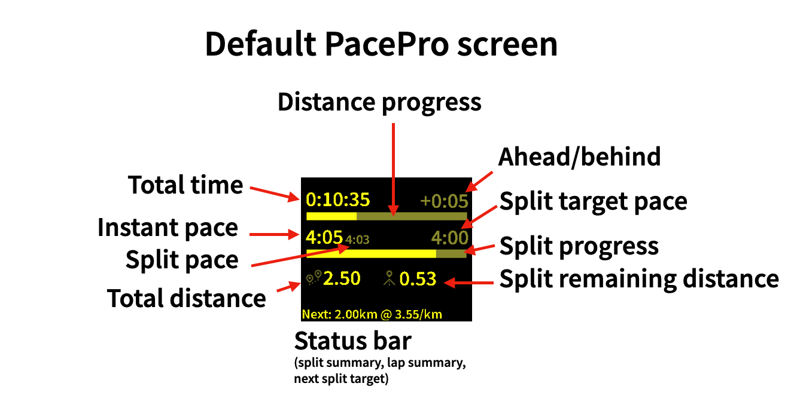

# Race and Workout Pacer for Engo and ActiveLook
If you own a pair of ActiveLook glasses (like the Engo 2 or 3, or Junbo Evad) you'll be aware that the configuration of the Garmin watch integration is a little tricky.  This is still the case with this new data field.  However, it delivers some functionality that fulfils the true potential of these glasses.

## Features added on top of those provided by the standard ActiveLook data field
* Full-screen overlay on lap change removed
* Status text at the bottom of the screen for lap updates
* Fenix 8 / Forerunner 970 or above: tap the data field on the watch to rotate through screens
* Separate configuration for trail running
* Workout screens with workout metrics and widgets
* Fenix 8 / Forerunner 970 or above: PacePro screens with PacePro metrics and widgets

## Settings
The settings screen now has the option to configure trail running screens separate from other types of running.  For running and trail running, it also allows you to define a screen shown for workouts, and a screen for PacePro plans.  These screens take up screen slots, so with both options enabled, you are able to define at most two other data screens.  Aside from that, screens are configured the same way as for the standard data field.

On top of the [standard ActiveLook data fields](https://intercom.help/engo-eyewear/en/articles/10982792-garmin-data-fields-for-use-with-activelook), the following are also available:
| ID | Feature |
| -- | ------- |
| 48 | Workout step distance |
| 49 | Workout step remaining distance |
| 50 | Workout step remaining time |
| 51 | Workout step actual pace |
| 52 | Workout step target pace |
| 53 | Workout step time |
| 54 | Workout ahead/behind |
| 55 | Workout step ahead/behind |
| 56 | Workout step pace widget |
| 57 | PacePro split actual distance |
| 58 | PacePro split remaining distance |
| 59 | PacePro split target distance |
| 60 | PacePro split actual pace|
| 61 | PacePro split target pace |
| 62 | PacePro split remaining elevation |
| 63 | PacePro split time |
| 64 | PacePro split ahead/behind |
| 65 | PacePro overall ahead/behind |
| 66 | PacePro time widget |
| 67 | PacePro split pace widget |

## Workouts
When the workout screen is enabled for running or trail running, workouts are detected automatically at timer start, and the workout screen will be shown.  Here you can see the behaviour of the workout pace widget, showing current pace, average pace for the step and target pace for the step, as well as an indication of the progress through the step.  You can still rotate through the other screens you have configured.

## PacePro (Fenix 8 / Forerunner 970 or above)
To set up PacePro, you will need to copy the PacePro strategy table from Garmin Connect and paste it into the relevant part of the Settings app.  When you do this, the line breaks will disappear, replaced by spaces.  Don't worry - at the time of writing (October 2026) the data field will correctly ingest your pace plan.  Just ensure that there are no extra spaces at the start or end of the pace plan, and it will load correctly.  *Why, oh why, do we have to do this?!* I hear you cry.  Simply put: The Garmin API provides information of when a PacePro split starts and when it ends.  Data fields have no way of receiving any information about the pace plan, only statistics about each leg of the plan after they end.
### Copying the plan

### Pasting the plan

### PacePro operation
When the PacePro screen is enabled for running or trail running, PacePro races are detected automatically as soon after starting the timer as the watch detects that you are on course, and the PacePro screen is shown.  If at any point the pace plan gets out of sync due to Garmin not detecting splits correctly, you can recalculate the plan by double-tapping on the data field on the watch.

### Important note
All fields relating to PacePro are calculated by this data field based on the pasted pace plan.  This means that the split pace, distance, and especially ahead/behind may not line up exactly.  At the start of the next split, the ahead/behind should match.  The watch has the luxury of using GPS location to know exactly where you are along the route, and it calculates pace and ahead/behind based on those details.  This data field does not have access to the route, and so can only calculate based on distance and time.  This has been tested in training and race conditions - on some multi-lap courses or when the race route does not exactly conform to the course set, the watch can go off track, and if the watch gets confused, the glasses will get confused too, and won't tick over to the correct step.  When this happens, double-tapping the data field on the watch will recalculate the strategy on the glasses - *meaning you'll have useful PacePro stats even when your watch doesn't!*  The data field also contains logic to "debounce" if the watch sends too many split-change notifications - so the data field should stay on track in this scenario.  There are limits to how smart the data field can be; this logic is the best that can be done given the very limited access to PacePro data.
